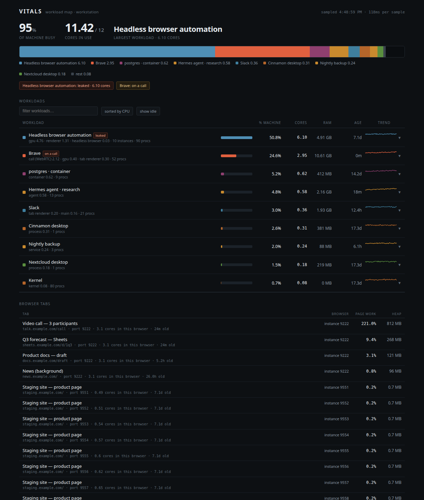

# Vitals

**A workload map for a browser-shaped computer.**

Every process monitor tells you which PID is hot. Nobody thinks in PIDs. Vitals
groups processes under the thing a human named — an app, a container, an agent,
a browser instance — and then crosses the boundary every other monitor stops at:
the browser. Tabs get their own numbers, so you can tell the Excel sheet that is
crashing your machine from the video call.



## The problem

On a normal desktop, one browser is 40 to 60 processes. GNOME System Monitor
shows them as 60 identical rows named `brave`, with no age, no parent, and no
idea which one is the tab that is killing you. When ten headless browser
instances leaked from an automation run and sat on a staging page for seven days,
the monitor could not say any of this:

- that they were orphans (their launcher was long dead)
- that they were seven days old
- that their pages were idle while their GPU processes burned six cores
- which instance was which

Vitals answers all four, in one screen, without root.

## What it actually measures

Three layers, joined:

**1. Identity.** Every process is resolved to a human name using the strongest
signal available, in order: docker container, flatpak app id, systemd unit, the
top of its own process tree, or the script it runs. Kernel threads collapse to
one row. `labels.json` is where you teach it your own names.

**2. Tabs.** Chrome-family browsers that speak the Chrome DevTools Protocol are
attached per tab. `Performance.getMetrics` gives main-thread task time, script
time, heap and DOM nodes for each tab. `SystemInfo.getProcessInfo` gives
per-process CPU where the ids are real PIDs. Joining those two is what makes the
verdict possible.

**3. Verdict.** A sentence, in English:

> pages are idle (0.02 cores of page work) — 6.93 cores burned by browser
> internals (compositor / raster / media), not by a tab

That is the diagnosis no process list can produce, because the offender is a
child process of a browser that owns an idle page.

## Units, and why your numbers never matched

System monitors disagree about denominators. GNOME System Monitor reports
**percent of the whole machine**. `top` and `ps` report **percent of one core**.
The same process is `19%` in one and `225%` in the other. Vitals shows both, on
the same row, always labeled:

- `% machine` — share of all cores, matches your desktop monitor
- `cores` — the fractional core count, matches `top`

## Quickstart

Requirements: Linux, Python 3.9+, a `/proc` filesystem. No dependencies, no
root, no agent installed inside your apps.

Want to see it without pointing it at your machine? `python3 server.py --demo`
serves a canned snapshot at the same URL, which is how the screenshot above was
made.

```bash
git clone https://forge.binaryranch.com/sastian/vitals.git
cd vitals
python3 server.py            # http://127.0.0.1:8791
```

Optional: run it as a user service so it is either up or reported, never a
silently orphaned process.

```bash
./install.sh                 # systemd --user unit, enabled at login
```

Options: `--port N`, `--host ADDR`, `VITALS_PORT` env var.

## Getting browser tabs

Tabs come from the DevTools Protocol, which a browser only exposes if it was
started with a debugging port. Chromium instances launched by automation usually
already have one, and Vitals scans ports 9500-9599 automatically. For your own
browser, add the flag once:

```bash
flatpak kill com.brave.Browser && flatpak run com.brave.Browser --remote-debugging-port=9222
```

or for Chrome/Chromium:

```bash
google-chrome --remote-debugging-port=9222
```

Tabs restore from session. Without the flag, Vitals still shows the browser's
process breakdown, age, memory and per-role CPU. It just cannot name the tabs,
and it tells you so instead of guessing.

**Security note, stated plainly:** a local debugging port lets any local process
drive that browser, including reading cookies for sites it is logged into. It
binds to `127.0.0.1` only, which keeps it off the network, but it is a real
tradeoff on a multi-user machine. Use a dedicated profile if that matters, and
close the browser when you do not need tab-level detail.

## Reading the screen

- **Machine bar** — every core on the box, split by workload. Hover a legend
  entry to find its row.
- **Workload rows** — name, roles that are consuming CPU, `% machine`, `cores`,
  RAM, age, 5-minute trend. Click any row to open its processes and history.
- **Flags** — `leaked` means reparented to PID 1 and older than an hour, which
  is the signature of an automation run that died without cleaning up. `on a
  call` means a WebRTC renderer is actually burning, not merely present.
- **Browser tabs** — every tab from every DevTools-speaking browser, sorted by
  page work, with the owning browser instance, its port, its age, and how many
  cores that whole instance is using. The gap between those two numbers is the
  whole point.

## What it deliberately does not do

- **No root, no eBPF, no agents.** It reads `/proc`, `cgroup`, `flatpak ps`,
  `docker ps`, `ss` and `wmctrl`. Everything else is arithmetic.
- **No killing.** Vitals reports. Reaping is a separate, explicit action.
- **No history beyond five minutes in memory.** Nothing is written to disk.
- **No guessing about tabs.** If a browser has no debugging port, its tabs are
  unknown, and the UI says so.

## Limitations

`/proc/<pid>/fd` and `/proc/<pid>/io` require ptrace permission, so socket and
file attribution is limited to what `ss` reports. Per-tab GPU cost is inferred
from the instance's process breakdown rather than attributed per tab, because
Chromium does not expose that mapping over CDP. Kernel-thread grouping is
coarse by design.

## Roadmap

- reaping leaked browser instances from the UI, with the age and orphan
  evidence shown before the button
- persisted history, so a spike at 03:00 is still there at 09:00
- per-tab process attribution via `Target.getTargetInfo` where the platform
  allows it
- a second adapter for non-Chromium browsers through their own remote protocols
- macOS and BSD sampling backends, same model

## License

MIT. See [LICENSE](LICENSE).
